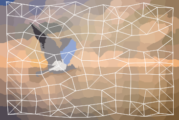
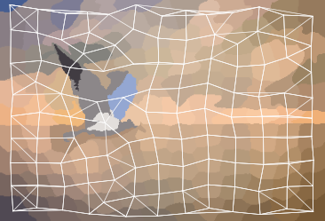
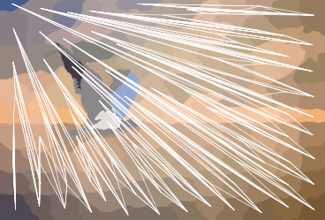

# Analysis of the Impact of Distance Metrics on Graph Construction for Graph Neural Networks

This project explores the possibility of interpreting images as graphs and further classifying them using **Graph Neural Networks (GNNs)**. The study analyzes the impact of various graph construction approaches derived from 2D images—specifically comparing bilinear interpolation and SLIC superpixel segmentation as well as the influence of different distance metrics (Euclidean, Manhattan, and Cosine Similarity) on model performance.

## Dataset
* **Source:** *Drone/Bird Classify Fasiai* (available on [Kaggle](https://www.kaggle.com/code/stpeteishii/drone-bird-classify-fasiai/input)).
* **Composition:** 330 total images (165 birds, 165 drones) with binary labels.
* **Split:** 70% Training / 30% Validation (random split).

## Experimental Setup
* **Epochs:** 100
* **Batch Size:** 16
* **Learning Rate:** 0.001 (ADAM optimizer)
* **Weight Decay:** 0.0005 (ADAM optimizer)
* **SLIC Compactness:** 10.0
* **Random Seed:** 42

**Tested Hyperparameter Ranges:**
* **Hidden Channels:** 32, 64
* **Bilinear Interpolation Resolution:** $k \in \{8, 16, 32\}$
* **SLIC Superpixels ($n$):** $n \in \{60, 120, 240\}$
* **Nearest Neighbors ($k$):** $k \in \{4, 8, 16\}$
* **Distance Metrics:** Euclidean, Manhattan, Cosine Similarity

## Image-to-Graph Transformation
One of the core highlights of this project is converting unstructured 2D images into structured graph representations that Graph Neural Networks can process. The pipeline investigates and compares two main image preprocessing and graph construction strategies:

1. **SLIC Superpixel Segmentation:** Grouping pixels into perceptually meaningful regions (superpixels) to better capture the actual shape, boundaries, and color features of objects.
2. **Bilinear Interpolation:** Reducing image resolution to simplify the structure and construct graphs based on a regular pixel grid.
3. **Graph Edge Construction:** Connecting nodes using different distance metrics (Euclidean, Manhattan, and Cosine similarity) to define the graph topology.

*Example of graph structures generated over image segments using different configurations:*
<table>
  <tr>
    <td align="center"> <b>Euclidean</b></td>
    <td align="center"> <b>Manhattan</b></td>
    <td align="center"> <b>Cosine Similarity</b></td>
  </tr>
</table>

## Model Architectures
Eight GNN model variations were evaluated, comprising Convolutional layers (GCNConv, GATConv), Global Mean Pooling, and Multi-Layer Perceptron (MLP) layers.

| Layer | GCN1 | GCN2 | GAT1 | GAT2 | MIX1 | MIX2 | MIX3 | MIX4 |
| :--- | :--- | :--- | :--- | :--- | :--- | :--- | :--- | :--- |
| **Message Passing** | GCNConv (x3) | GCNConv (x6) | GATConv (1 head) GATConv (2 heads) | GATConv (1 head) GATConv (5 heads) | GCNConv GATConv (1 head) GCNConv | GCNConv (x2) GATConv (1 head) | GATConv (1 head) GCNConv GATConv (1 head) | GATConv (1 head) GATConv (1 head) GCNConv |
| **Aggregation** | Global Mean Pool | Global Mean Pool | Global Mean Pool | Global Mean Pool | Global Mean Pool | Global Mean Pool | Global Mean Pool | Global Mean Pool |
| **MLP** | Linear (x2) | Linear (x2) | Linear (x2) | Linear (x2) | Linear (x2) | Linear (x2) | Linear (x2) | Linear (x2) |

## Key Findings & Conclusions
1. **Impact of Distance Metrics:** Distance metric selection heavily influences GNN performance. **GCN-based architectures** achieved optimal performance with the **Euclidean metric** (due to neighborhood feature averaging), whereas **GAT-based architectures** performed better with the **Manhattan metric**, which produced more diverse neighborhoods well-suited for the attention mechanism.
2. **Feature-Based Edges:** Graph construction that incorporates color feature similarity achieves higher classification performance than purely spatial/geometric graph connections.
3. **Superpixels vs. Interpolation:** Image simplification using SLIC superpixel segmentation better captures the underlying physical structure of objects in graph representation. In contrast, bilinear interpolation reduces spatial resolution into a regular pixel grid.